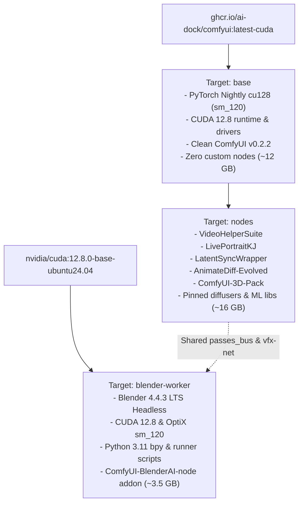

# Design Spec: Multi-Tier Docker Image Matrix & Modular VFX Orchestration

**Status:** Proposed  
**Author:** AI Coding Assistant & Tal Shmuli  
**Date:** 2026-10-30  
**Target Workstation:** NVIDIA GeForce RTX 5090 Blackwell (32GB GDDR7, sm_120) / AMD Ryzen 9 9950X3D  
**Repository:** `talshmuli/comfyui-blackwell-docker` (`feat/matrix-builds-blender-worker`)

---

## 1. Executive Summary & Motivation

### The Problem
Modern generative VFX and 3D character animation require a synchronized software stack combining:
1. Deep learning frameworks compiled with bleeding-edge Blackwell `sm_120` CUDA 12.8 kernels.
2. ComfyUI with a delicate web of custom nodes (LivePortrait, LatentSync, VideoHelperSuite, AnimateDiff).
3. 3D kinematic modeling engines (Blender 4.4 LTS headless) for procedural rigging and geometric AOV passes.

Packaging everything into a single monolithic 19 GB container forces users with lightweight workflows (e.g., text-to-image or custom node development) to pull gigabytes of unwanted 3D rendering tooling. Conversely, running disparate manual environments causes dependency and ABI hell.

### The Solution: 3-Tier Lean Matrix + Modular Studio Microservices
We introduce a 3-tier lean Docker build matrix and a modular Docker Compose orchestration system:
* **Tier 1 (`base`):** Minimalist ComfyUI core on PyTorch Nightly CUDA 12.8 sm_120 (~12 GB).
* **Tier 2 (`nodes`):** Generative video & character animation workstation (~16 GB) with all verified video/portrait custom nodes.
* **Tier 3 (`blender-worker`):** Lean headless Blender 4.4 LTS pass renderer (~3.5 GB) with OptiX/CUDA sm_120 acceleration and automated API runners.

**Why Lean Microservices Beat a 19 GB Monolith:**
Packaging Blender and ComfyUI into a single 19 GB container forces unwanted bloat on image diffusion workflows and couples Blender rendering crashes with ComfyUI web server stability. By separating the stack into a 16 GB ComfyUI node and a 3.5 GB Blender worker connected via an isolated render bus (`passes_bus`) and bridge network (`vfx-net`), each service maintains independent lifecycle, memory management, and scaling.

---

## 2. Docker Architecture & Multi-Stage Target Hierarchy



### Stage Details

1. **`base` (Target: `base`)**:
   - Base: `ghcr.io/ai-dock/comfyui:latest-cuda`
   - Actions: Installs PyTorch nightly cu128, uninstalls xformers (ABI safety), installs CUDA 12.8 drivers.
   - Nodes: 0 custom nodes (~12 GB).

2. **`nodes` (Target: `nodes`)**:
   - Base: `base`
   - Custom Nodes: `ComfyUI-VideoHelperSuite`, `ComfyUI-LivePortraitKJ`, `ComfyUI-LatentSyncWrapper`, `ComfyUI-AnimateDiff-Evolved`, `ComfyUI-3D-Pack`.
   - Python Libraries: Pinned `diffusers>=0.30.0,<0.31.0`, `huggingface-hub<1.0`, `insightface`, `mediapipe<0.10.15`, `onnx<1.16`, `plyfile`, `trimesh`, `pyhocon`.
   - Size: ~16 GB.

3. **`blender-worker` (Target: `blender-worker`)**:
   - Dedicated headless worker from `nvidia/cuda:12.8.0-base-ubuntu24.04`.
   - Installs Blender 4.4.3 Linux x64 tarball, adds symlink `/usr/local/bin/blender`.
   - Copies automated render scripts (`blender_runner.py`, `blender_entrypoint.sh`) and installs `ComfyUI-BlenderAI-node` to `/opt/blender/4.4/scripts/addons/`.
   - Size: ~3.5 GB.

---

## 3. GitHub Actions CI Matrix (`build.yml`)

The CI workflow will execute a parallel matrix build strategy:

```yaml
jobs:
  build-and-publish:
    runs-on: ubuntu-24.04
    strategy:
      fail-fast: false
      matrix:
        flavor:
          - target: base
            tag_suffix: base
            test_type: core
          - target: nodes
            tag_suffix: nodes
            test_type: custom_nodes
          - target: blender-worker
            tag_suffix: blender-worker
            test_type: blender
```

### CI Step Pipeline for Each Matrix Worker:
1. Checkout code (`actions/checkout@v7`).
2. Secret scan with TruffleHog.
3. Build container with `docker/buildx` targeting `--target ${{ matrix.flavor.target }}`.
4. Run automated sm_120 and flavor-specific integrity tests (`core`, `custom_nodes`, or `blender`).
5. Audit filesystem for exposed credentials.
6. Aqua Security Trivy vulnerability scan (`format: table` and `format: sarif`).
7. Upload SARIF to GitHub Security Tab via `github/codeql-action/upload-sarif@v4` (zero deprecations, categorized per flavor).
8. Upload SARIF artifact via `actions/upload-artifact@v4` (downloadable on Actions run page).
9. Tag and publish to `ghcr.io/talshmuli/comfyui-blackwell-docker:<version>-<flavor>`.

---

## 4. Docker Compose Orchestration (`docker-compose.yml`)

`docker-compose.yml` provides four operational profiles:

### 1. Modular Studio Profile (`--profile modular`, Default Recommended)
Runs `comfyui` (`nodes` image) and `blender-worker` connected via shared volume `passes_bus` and bridge network `vfx-net`.

### 2. Dev Profile (`--profile dev`)
Runs `comfyui-base` (clean core) and `blender-worker` for minimal debugging.

### 3. Standalone Nodes Profile (`--profile nodes`)
Runs `comfyui` alone with all custom nodes.

### 4. Standalone Base Profile (`--profile base`)
Runs `comfyui-base` alone without custom nodes or Blender.

---

## 5. Safety & Zero Impact to Running Production Environment
* The host currently has a running container `comfyui` on port `8188`.
* All local build testing will build isolated tags (`local-test-base:test`, `local-test-nodes:test`, `local-test-blender:test`).
* Compose integration tests will run on test port `8189` and test network `vfx-test-net` with `docker compose -p test-modular up`, ensuring zero interruption or port collision with the live system.

---

## 6. Documentation Enhancements

`README.md` will be updated with:
1. **The 4-Tier Matrix Table:** Specs, sizes, and recommended use cases.
2. **Expanded Motivation: The One-Stop Shop Rationale:**
   - Why containerized CUDA 12.8 + sm_120 is essential for Blackwell RTX 5090 / 5080.
   - Why microservices (`nodes` + `blender-worker`) provide crash-resilient 3D-to-neural rendering.
   - Comprehensive workflow examples for both modular and monolithic deployments.
